<!-- SVGs in assets/ come from assets/build.py; the stats cards from assets/stats.py (refreshed daily) -->

  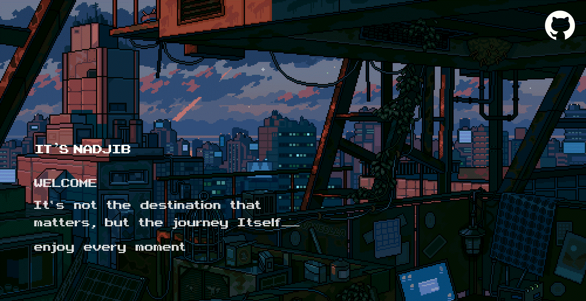

  I'm an AI engineer and researcher based in Nancy, France, specialised in <b>RAG, GraphRAG and agentic AI</b>.
  I design systems where large language models reason over knowledge graphs: retrieval that understands structure,
  agents that plan and use tools, and LLMs that decide instead of guess. My work spans many domains, from
  <b>biomedical knowledge graphs</b> at Inria / LORIA and <b>banking fraud detection</b> with GNNs to <b>medical imaging</b>,
  <b>Arabic NLP</b> and <b>autonomous ROS2 robots</b>, and I take research ideas all the way to working systems.

 <a href="https://orcid.org/0009-0009-9004-9580"></a><a href="https://www.researchgate.net/profile/Zahaf-Boualem-Nadjib"></a>

 

  <a href="https://github.com/Z-Nadjib/EntityAlignment-PGxLOD"></a>
  <a href="https://github.com/Z-Nadjib/EntityAlignment-Nexus"></a>
  
  <a href="https://doi.org/10.18653/v1/2024.arabicnlp-1.84"></a>
  <a href="https://doi.org/10.1109/PAIS66004.2025.11126465"></a>
  

 

  
  
  
  

 

  <a href="https://github.com/Z-Nadjib/Autonomous-Driving-End-To-End"></a>
  <a href="https://github.com/Z-Nadjib/Pepper-Robot-Library-Assistant"></a>
  <a href="https://github.com/Z-Nadjib/PACR-Solutions"></a>
  <a href="https://github.com/Z-Nadjib/Robot-Cartographe-Slam"></a>

 

  
  
  
  

 

  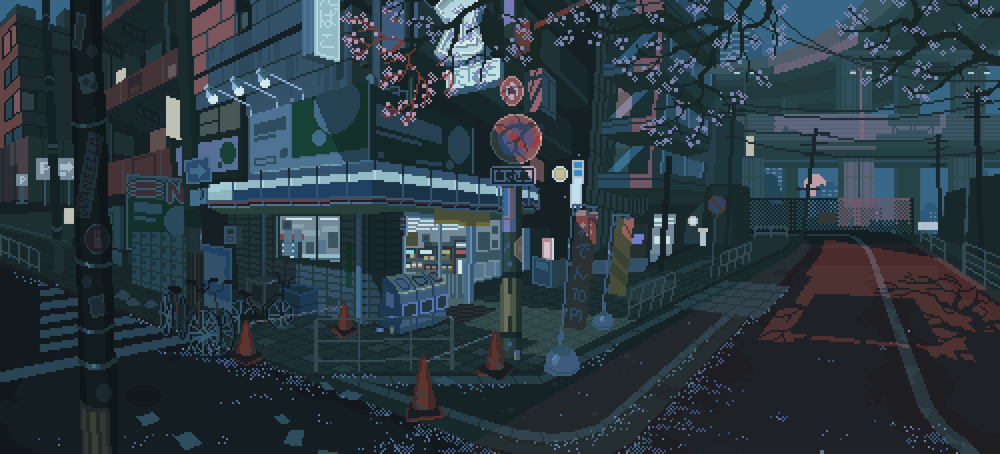

